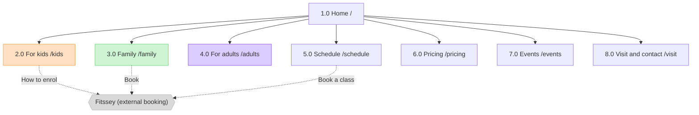

# Site map

- **Status:** Approved by Martyna, 2026-11-26 (v3)
- **Visual version:** FigJam board "Find Balans — Information Architecture" — https://www.figma.com/board/tGPi2ehB7RWNQ9CBBaI4mJ
- **Source of truth:** this file. Routes in `src/pages/` must match the URLs below. Change this file (via a pull request) before adding, removing or renaming a page.

## Rules

- English is the primary language. Polish pages use the same paths under `/pl/` (for example `/pl/kids`).
- Every `↗` item links to Fitssey (`https://app.fitssey.com/findbalans`) in a new tab. We link to booking; we never rebuild it.
- Every page has the same header (logo, navigation, language switch EN / PL, Book button) and footer (contact, portfolio notice).

## Pages

| ID  | Page            | URL         | Audience | Main content                                                                                                                                                     |
| --- | --------------- | ----------- | -------- | ---------------------------------------------------------------------------------------------------------------------------------------------------------------- |
| 1.0 | Home            | `/`         | Everyone | Entry points for kids, family and adults                                                                                                                         |
| 2.0 | For kids        | `/kids`     | Parents  | 2.1 Aerial hammocks · 2.2 Ages 5–6, 7–10, 11–14 · 2.3 Disco dance (5–6) · 2.4 Choreo dance (open age) · 2.5 Closed groups Sep–Jun · 2.6 How to enrol ↗ · 2.7 FAQ |
| 3.0 | Family          | `/family`   | Families | 3.1 Family aerial hammocks · 3.2 Children 5+ with an adult · 3.3 Book ↗                                                                                          |
| 4.0 | For adults      | `/adults`   | Adults   | 4.1 Aerial hammocks · 4.2 Aerial hoop · 4.3 Handstand · 4.4 All levels welcome                                                                                   |
| 5.0 | Schedule        | `/schedule` | Everyone | 5.1 Filter by audience (kids / family / adults) · 5.2 Weekly plan · 5.3 Book a class ↗                                                                           |
| 6.0 | Pricing         | `/pricing`  | Everyone | 6.1–6.3 Kids prices · 6.4–6.5 Adult prices · 6.6 Family price                                                                                                    |
| 7.0 | Events          | `/events`   | Everyone | 7.1 Birthday parties · 7.2 Photo sessions                                                                                                                        |
| 8.0 | Visit & contact | `/visit`    | Everyone | 8.1 Address and free parking · 8.2 Email contact · 8.3 Map link                                                                                                  |

## Diagram

