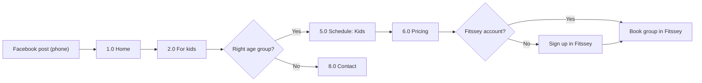
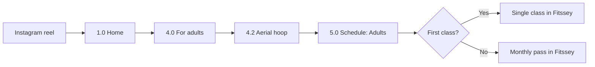

# User flows

- **Status:** Draft for review, 2026-11-26
- **Visual version:** same FigJam board as the site map — https://www.figma.com/board/tGPi2ehB7RWNQ9CBBaI4mJ
- **Use:** every page and component must support at least one step in these flows. If a component does not serve a flow, question whether it is needed.

## Flow 1 — Parent enrolling a child

Context: mobile first; arrives from a Facebook post.

Key worries: right age group · safety · fixed place for the season · price · getting there and parking.

Design implications (proposed by Claude — review in this PR):

- Age groups must be visible on the For kids page without scrolling far.
- The Fitssey account step is explained in two simple steps before the user leaves our site.
- Parking and address appear on the kids page, not only on Visit & contact.

## Flow 2 — Adult trying aerial hoop

Context: arrives from an Instagram reel.

Key worries: "I'm not fit enough" · minimum height 140 cm · what to wear · price of one try.

Design implications (proposed by Claude — review in this PR):

- "All levels welcome" and the 140 cm minimum height appear next to the aerial hoop description.
- The single-class price (60 zł) is shown on the class card, so there is no need to visit Pricing first.
